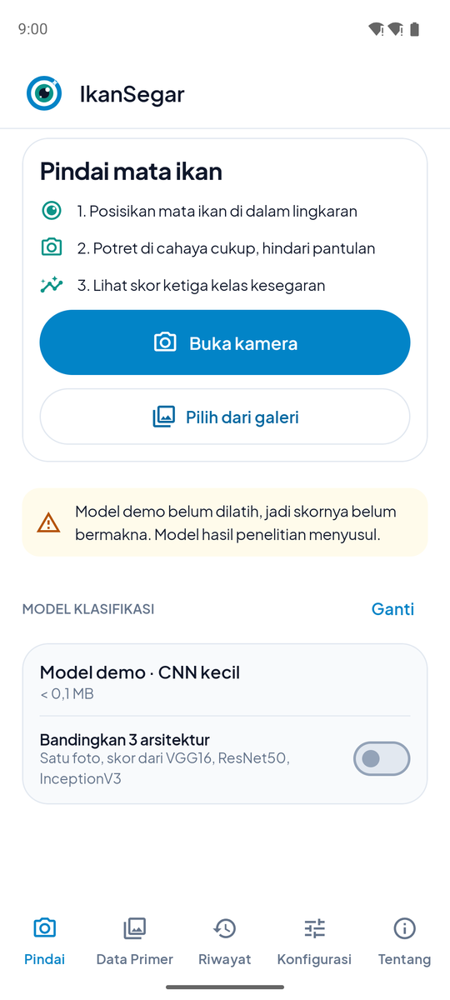
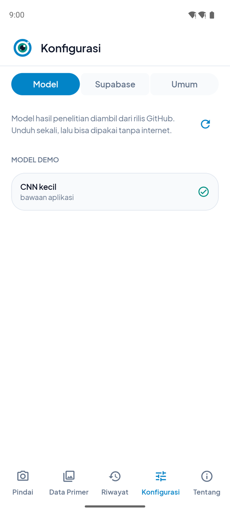
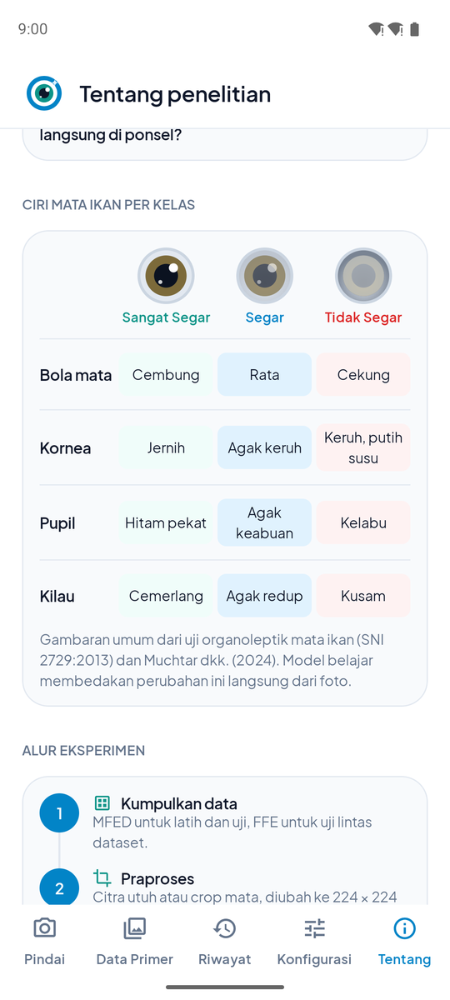

# Klasifikasi Kesegaran Ikan dari Citra Mata

Kode penelitian **"Perbandingan Efisiensi Arsitektur VGG16, ResNet50, dan InceptionV3 untuk Klasifikasi
Tingkat Kesegaran Ikan Berdasarkan Citra Mata dengan Inferensi di Ponsel"** (Ahmad Safrudin Kurniawan,
Teknik Informatika IIB Darmajaya, 2026).

- 3 kelas: **Sangat Segar** (Highly Fresh), **Segar** (Fresh), **Tidak Segar** (Not Fresh)
- Dataset utama **MFED** v2 (DOI 10.17632/67nmx3mhwh.2), dibagi 70:15:15 terstratifikasi
- Dataset eksternal **FFE** v1 (DOI 10.17632/xzyx7pbr3w.1), hanya untuk pengujian lintas dataset tanpa pelatihan ulang
- Transfer learning ImageNet, input 224×224, `preprocess_input` per arsitektur (ditanam di dalam model)
- Metrik: accuracy, precision, recall, F1 macro dan confusion matrix
- Efisiensi: jumlah parameter, ukuran `.keras`, waktu latih, latensi CPU 4 thread (batch 1, warm-up 10, 200 citra, diulang 3×), dan memori puncak (psutil)
- Grad-CAM dan uji McNemar antar-arsitektur

Skenario eksperimen beserta kemungkinan tambahannya: **[docs/skenario_eksperimen.md](docs/skenario_eksperimen.md)**.

## Aplikasi Android

Aplikasi **IkanSegar** menjalankan model di ponsel dan menampilkan skor ketiga kelas. Aplikasi ini juga dipakai untuk mengambil data primer di pasar: foto diberi label lalu diunggah ke Supabase. Model hasil penelitian diterbitkan sebagai rilis GitHub di repo ini, dan aplikasi mengunduhnya dari sana. Penjelasan lengkap dan tangkapan layar ada di **[mobile/README.md](mobile/README.md)**.

| Pindai | Konfigurasi · Model | Tentang |
| :---: | :---: | :---: |
|  |  |  |

## Instalasi

Membutuhkan [uv](https://docs.astral.sh/uv/). Python 3.13 akan diunduh otomatis oleh uv.

```bash
uv sync                    # TensorFlow 2.21 + Keras 3.15.1 dan pustaka lain
uv run pytest -q           # cek instalasi
```

**Memakai GPU RTX 4060 (laptop HP Victus):** TensorFlow ≥ 2.11 **tidak mendukung GPU di Windows native**.
Ada dua pilihan:

1. **WSL2 Ubuntu (disarankan):** pasang driver NVIDIA terbaru di Windows, lalu jalankan di dalam WSL:
   ```bash
   curl -LsSf https://astral.sh/uv/install.sh | sh
   uv sync --extra cuda
   uv run python -c "import tensorflow as tf; print(tf.config.list_physical_devices('GPU'))"
   ```
2. **Windows native:** jalan di CPU saja. Pelatihan akan sangat lambat.

## Alur kerja

```bash
uv run fishfresh download                 # MFED (~3,7 GB) + FFE (~4.392 citra) dari Mendeley
uv run fishfresh prepare                  # verifikasi citra, deduplikasi, split 70:15:15
uv run fishfresh train                    # latih VGG16, ResNet50, InceptionV3
uv run fishfresh evaluate                 # uji MFED (3.7.1) + FFE (3.7.2)
uv run fishfresh benchmark                # efisiensi CPU 4 thread (3.7.3)
uv run fishfresh gradcam                  # visualisasi Grad-CAM
uv run fishfresh summarize                # tabel perbandingan + uji McNemar
# atau sekaligus:
uv run fishfresh all
```

Opsi umum: `--archs vgg16 resnet50`, `--seeds 42 123 2026`, `-c configs/skenario/<file>.yaml`,
`--set train.batch_size=16 image_size=299`, `--exclude-ffe-overlap`.
Untuk Jupyter: `uv run jupyter lab` (kernel memakai env yang sama).

## Struktur

```
configs/default.yaml        konfigurasi utama (nilai proposal + asumsi bertanda)
configs/skenario/*.yaml     skenario tambahan K2–K7, K14
src/fishfresh/
  data.py                   scan, verifikasi, SHA-256/pHash, dedup, split, tf.data
  augment.py                rotasi, gamma, noise, perspektif, flip, brightness
  models.py                 VGG16/ResNet50/InceptionV3 + head, preprocess di dalam model
  train.py                  2 fase: feature extraction → fine-tuning
  evaluate.py               metrik macro, confusion matrix, per spesies (FFE), ΔF1
  efficiency.py             benchmark CPU 4 thread di subprocess terisolasi
  gradcam.py                heatmap lapisan konvolusi terakhir
  summarize.py              rekap CSV + McNemar
data/splits/                manifest & pembagian data (CSV, dibuat oleh `prepare`)
outputs/<run>/seed<k>/<arch>/  model, kurva, metrik, prediksi, efisiensi, Grad-CAM
```

## Lisensi data

MFED dan FFE berlisensi CC BY 4.0. Kutip DOI di atas saat menggunakannya.
