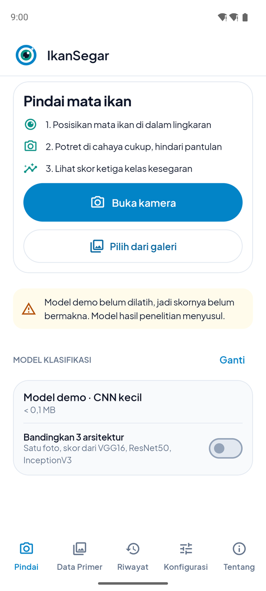
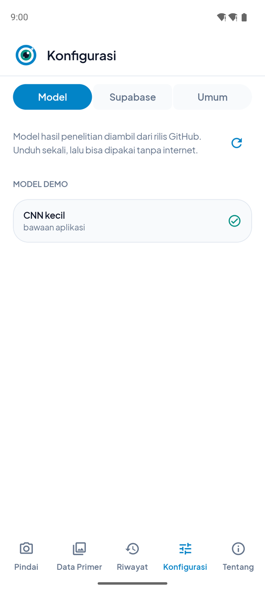
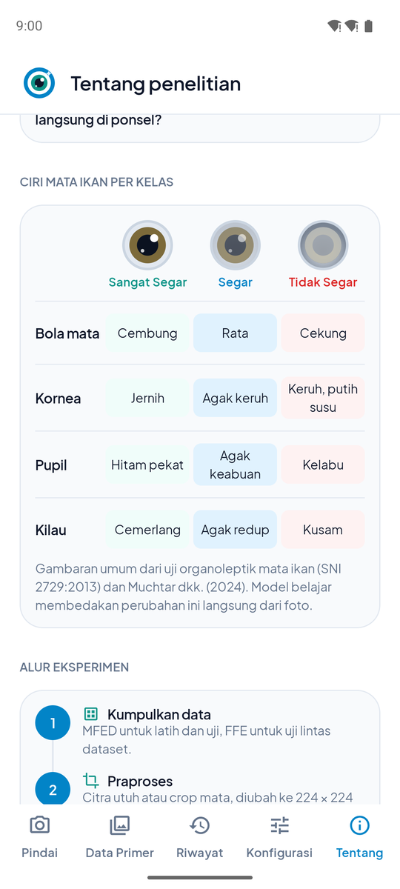

# IkanSegar app-v0.1.0 (pre-release)

Rilis pertama aplikasi Android **IkanSegar**, pendamping penelitian klasifikasi kesegaran ikan dari citra mata dengan VGG16, ResNet50, dan InceptionV3.

## Fitur

- **Pindai.** Kamera dilengkapi panduan berbentuk kepala ikan. Crop mata yang dihasilkan identik dengan data latih. Hasilnya memuat **semua skor kelas** (Sangat Segar, Segar, Tidak Segar) beserta waktu praproses dan inferensi di ponsel, ditambah mode untuk membandingkan tiga arsitektur.
- **Data primer.** Label dipilih sebelum skor model tampil, lalu dilengkapi kode ikan, jenis ikan, dan pasar. Data disimpan offline-first dan diunggah otomatis ke Supabase tanpa login.
- **Riwayat.** Hasil pindai bisa ditampilkan sebagai list atau kartu.
- **Konfigurasi.** Unduh dan perbarui model per skenario, atur Supabase (uji koneksi, status unggah), dan ubah setelan umum.
- **Tentang.** Infografis eksperimen, identitas peneliti, dan ciri mata per kelas.

## Model

- **Model bawaan APK masih model demo** (CNN kecil berbobot acak), sehingga skornya belum bermakna. Hal ini ditandai jelas di aplikasi.
- Model hasil penelitian diterbitkan sebagai rilis `model-<skenario>-s<seed>` di repo ini dan didaftarkan di `registry.json` (rilis `registry`).
- Aplikasi memeriksa registry setiap kali dibuka atau saat tombol ⟳ di **Konfigurasi → Model** diketuk. Model baru dan pembaruan muncul di sana tanpa perlu instal ulang APK.
- Saat sebuah model diperbarui, versi lama tetap dipakai sampai versi baru selesai diunduh dan lolos verifikasi SHA-256.

## Cara instal

1. Unduh `IkanSegar-0.1.0.apk` (±22 MB, Android 8.0 / API 26 ke atas) dari halaman ini.
2. Buka berkasnya. Jika muncul peringatan, izinkan **Instal aplikasi tidak dikenal** untuk browser atau pengelola berkas yang dipakai.
3. Pilih **Instal**. Saat kamera pertama kali dibuka, pilih **Izinkan**.

## Izin

Aplikasi meminta izin kamera (saat dipakai) dan internet (untuk unggah data primer dan unduh model). Galeri memakai Photo Picker, sehingga tidak perlu izin penyimpanan.

## Tanda tangan

Sertifikat `CN=IkanSegar, O=Penelitian Kesegaran Ikan, C=ID`, SHA-256 `1d900b5ce92d5e221a4173ddce152b24da3fa389c2272363d33a7b5dfd4332b9`. Versi berikutnya ditandatangani dengan kunci yang sama, sehingga bisa dipasang menimpa versi ini.
