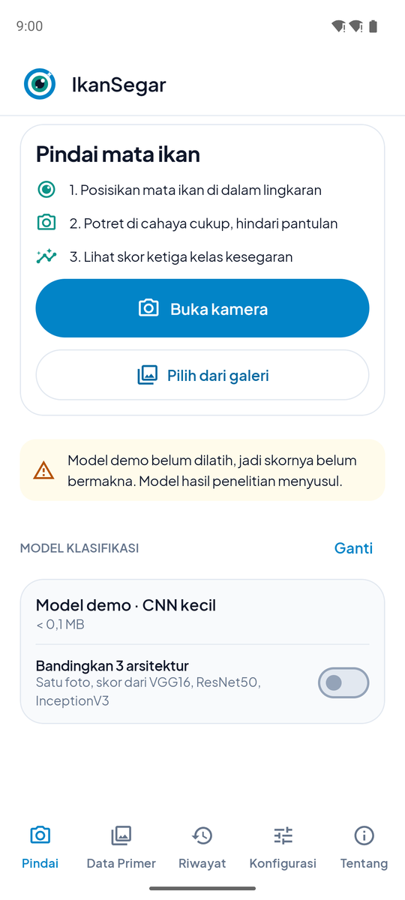
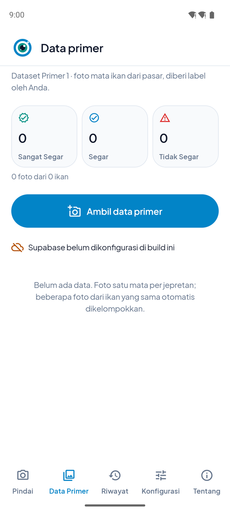
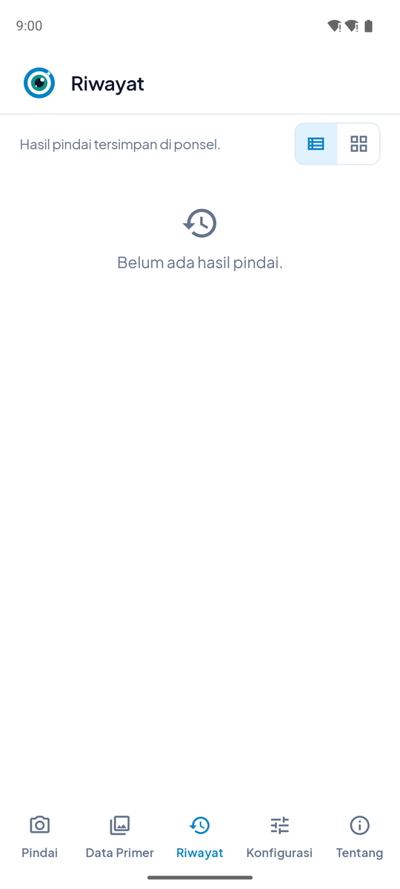
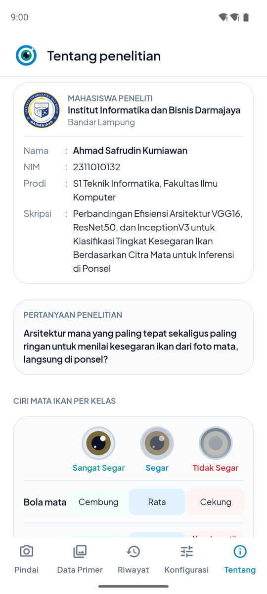
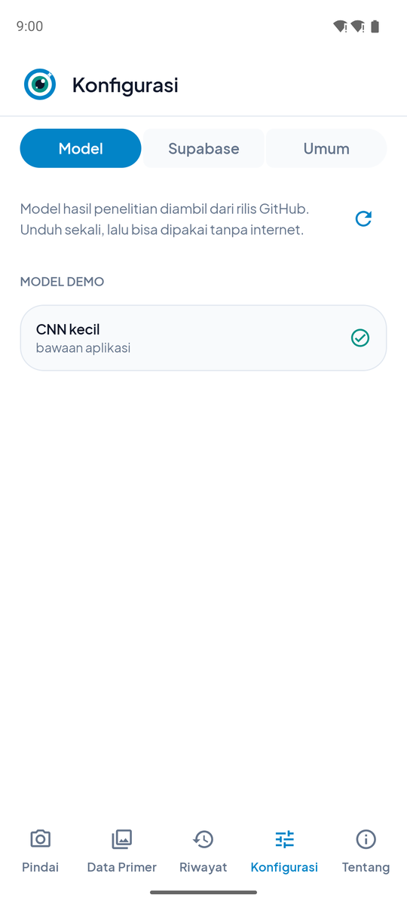
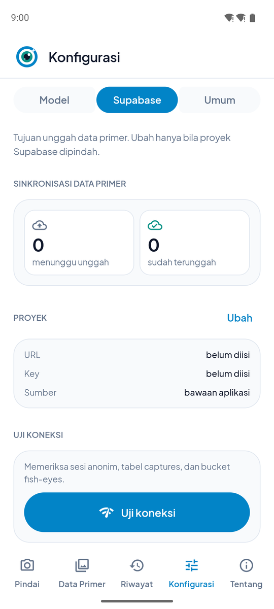
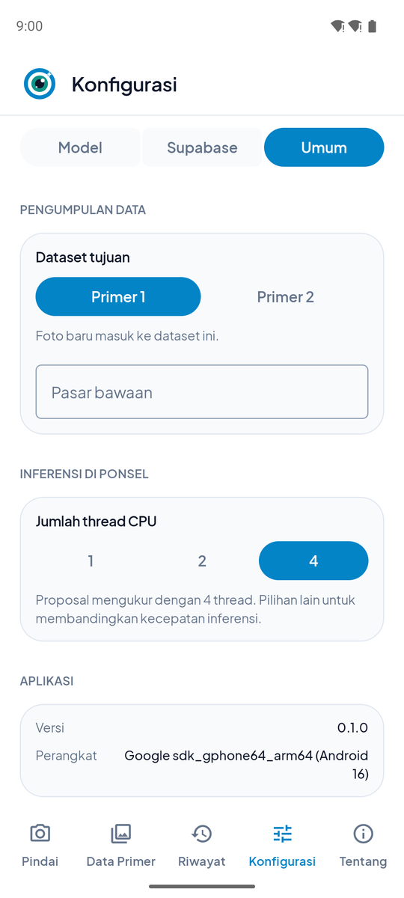
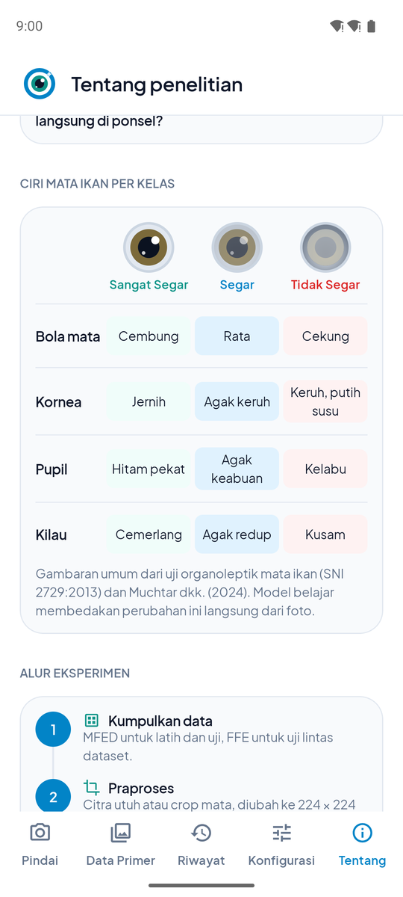

# IkanSegar (Android)

Aplikasi Android pendamping penelitian kesegaran ikan berdasarkan citra mata. Aplikasi ini punya dua fungsi:

1. **Pindai.** Memotret mata ikan, lalu menampilkan **semua skor** ketiga kelas: Sangat Segar, Segar, dan Tidak Segar. Model berjalan di ponsel dengan LiteRT, jadi tetap bisa dipakai tanpa internet.
2. **Data primer.** Memotret mata ikan di pasar dan memberinya label. Data disimpan dulu di ponsel (offline-first), lalu diunggah ke Supabase begitu ada internet. Hasilnya dipakai untuk validasi lapangan.

## Tampilan

| Pindai | Data primer | Riwayat | Tentang |
| :---: | :---: | :---: | :---: |
|  |  |  |  |

| Konfigurasi · Model | Konfigurasi · Supabase | Konfigurasi · Umum | Ciri mata per kelas |
| :---: | :---: | :---: | :---: |
|  |  |  |  |

Tangkapan layar di atas masih memakai model demo. Model hasil penelitian bisa diunduh dari menu Konfigurasi.

## Menu

| Menu | Isi |
| --- | --- |
| **Pindai** | Kamera dengan panduan berbentuk kepala ikan; mata diposisikan di dalam lingkaran. Hasilnya berupa kelas teratas, skor ketiga kelas (persen dan nilai mentah), waktu praproses dan inferensi, serta pilihan untuk membandingkan 3 arsitektur pada satu foto. |
| **Data Primer** | Label dipilih **sebelum** skor model tampil, supaya penilaian pengumpul tidak terpengaruh. Isian lain: jenis ikan, pasar, catatan, dan kode ikan; beberapa foto dari ikan yang sama tetap satu kelompok saat pembagian data. |
| **Riwayat** | Hasil pindai tersimpan di ponsel, bisa ditampilkan sebagai list atau kartu. Garis berwarna menunjukkan ketiga skor sekaligus. |
| **Konfigurasi** | **Model**: daftar model per skenario dari rilis GitHub; unduh, hapus, perbarui. **Supabase**: jumlah foto yang menunggu dan yang sudah terunggah, URL proyek dan key (ditampilkan tersamar), uji koneksi, kembalikan default. **Umum**: dataset tujuan, pasar bawaan, jumlah thread CPU. |
| **Tentang** | Identitas peneliti, ciri mata per kelas, alur eksperimen, data, arsitektur, skenario, dan metrik, disajikan sebagai infografis. |

## Arsitektur

Proyek ini memakai Kotlin Multiplatform dengan target Android saja, pola MVVM, dan Material 3 Expressive. Database lokalnya SQLDelight.

| Modul / folder | Isi |
| --- | --- |
| `shared/commonMain` | Domain, praproses (`ImageMath`), ViewModel, UI Compose, repositori SQLDelight, Koin |
| `shared/androidMain` | Kamera CameraX dengan overlay kepala ikan, LiteRT, penyimpanan foto, registry model, gateway Supabase, WorkManager |
| `shared/commonMain/sqldelight` | Skema database lokal |
| `androidApp` | `MainActivity`, splash screen, ikon, manifest, `BuildConfig` |
| `tools/gen_preprocess_fixture.py` | Fixture uji paritas praproses Kotlin terhadap Python |

Praproses di ponsel **identik** dengan pipeline pelatihan:

- Crop mata mengikuti `src/fishfresh/eye_roi.py::crop_eye` (Pillow LANCZOS, masker lingkaran).
- Citra utuh diubah ukurannya seperti `tf.image.resize(bilinear, antialias)`.

Kesamaan keduanya diuji oleh `PreprocessParityTest`.

## Model: GitHub Releases

Model hasil penelitian diterbitkan sebagai aset rilis di repo ini, sehingga bisa diunduh tanpa akun atau token:

- Rilis `model-<skenario>-s<seed>` berisi `<skenario>-<arsitektur>-s<seed>.tflite`. Catatan rilisnya memuat tabel metrik.
- Rilis `registry` berisi `registry.json`: daftar semua model beserta URL unduhan, SHA-256, dan metrik.

Aplikasi membaca `registry.json` setiap kali dibuka, atau saat tombol perbarui di Konfigurasi → Model diketuk. Model yang dipilih diunduh sekali, diverifikasi SHA-256-nya, lalu dijalankan secara offline. Model yang diekspor ulang punya SHA-256 baru, jadi aplikasi akan menawarkan unduhan ulang.

```bash
# dari root repo; butuh `gh` yang login dengan akses tulis ke repo
uv run python -m fishfresh.export_mobile -c configs/eye_mask.yaml --publish --default resnet50
uv run python -m fishfresh.export_mobile -c configs/eye_mask.yaml --bundle resnet50   # jadikan model bawaan APK
```

Model bawaan APK disimpan di `androidApp/src/main/assets/models/<id>.tflite` beserta `<id>.json`.

## Data primer: Supabase

Setiap instalasi mendapat identitas anonim tanpa layar login. Aturan RLS membatasi setiap ponsel agar hanya bisa melihat dan mengubah datanya sendiri. Foto masuk ke bucket `fish-eyes`, sedangkan label, metadata, dan skor masuk ke tabel `captures` dan `predictions`. Aplikasi hanya menyimpan **publishable key**; secret key ditolak.

Data primer ditarik ke laptop dengan `uv run python -m fishfresh.primer pull`. Skema Supabase dan uji RLS-nya ada di `../supabase/`.

## Build

```bash
cd mobile
cp local.properties.example local.properties   # isi sdk.dir; kunci Supabase opsional
./gradlew :shared:testAndroidHostTest           # uji paritas praproses
./gradlew :androidApp:assembleDebug
```

`SUPABASE_URL` dan `SUPABASE_PUBLISHABLE_KEY` dibaca dari `local.properties` atau dari variabel lingkungan. Kalau keduanya kosong, aplikasi tetap berjalan; yang nonaktif hanya unggah ke Supabase. Repo sumber model dapat diganti lewat `IKANSEGAR_MODELS_REPO`.

## Izin aplikasi

| Izin | Keterangan |
| --- | --- |
| `CAMERA` | Diminta saat runtime, dengan penjelasan. Bila ditolak permanen, aplikasi mengarahkan ke Setelan. |
| `INTERNET`, `ACCESS_NETWORK_STATE` | Untuk unggah ke Supabase, unduh model, dan constraint jaringan WorkManager. |
| Galeri | Memakai Photo Picker, jadi tidak perlu izin penyimpanan. |

## Lisensi pihak ketiga

Font Plus Jakarta Sans berlisensi SIL OFL 1.1 (lihat `licenses/PlusJakartaSans-OFL.txt`).
